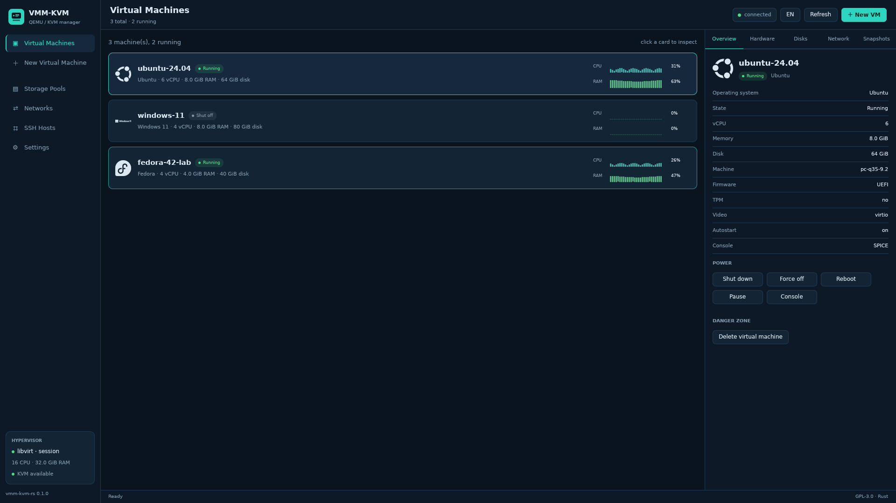
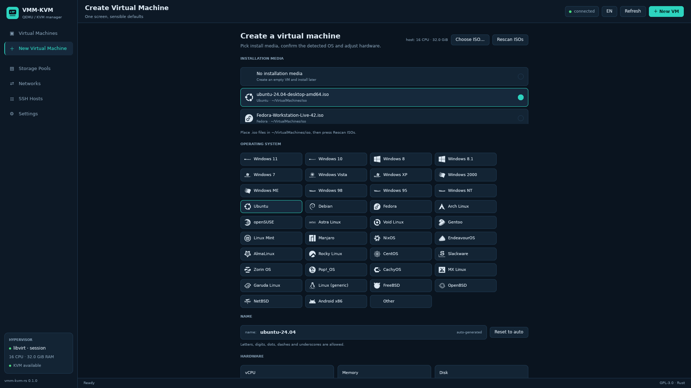
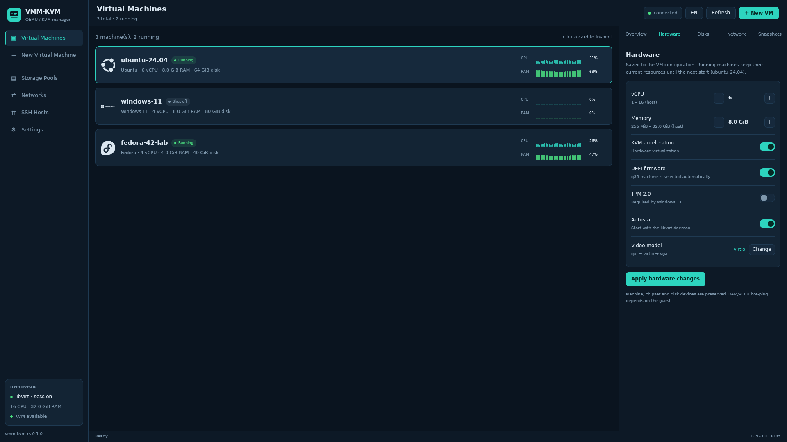
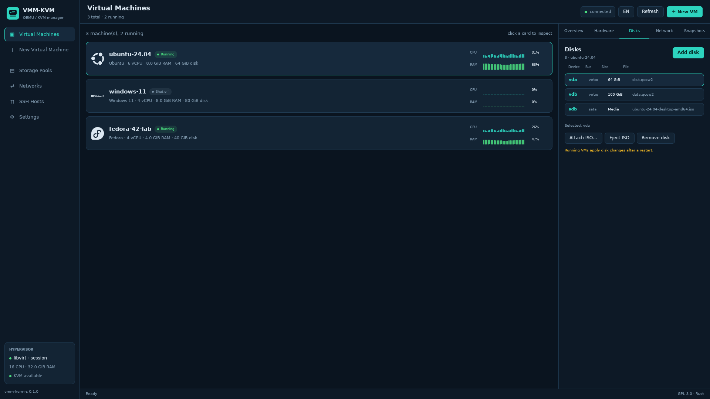
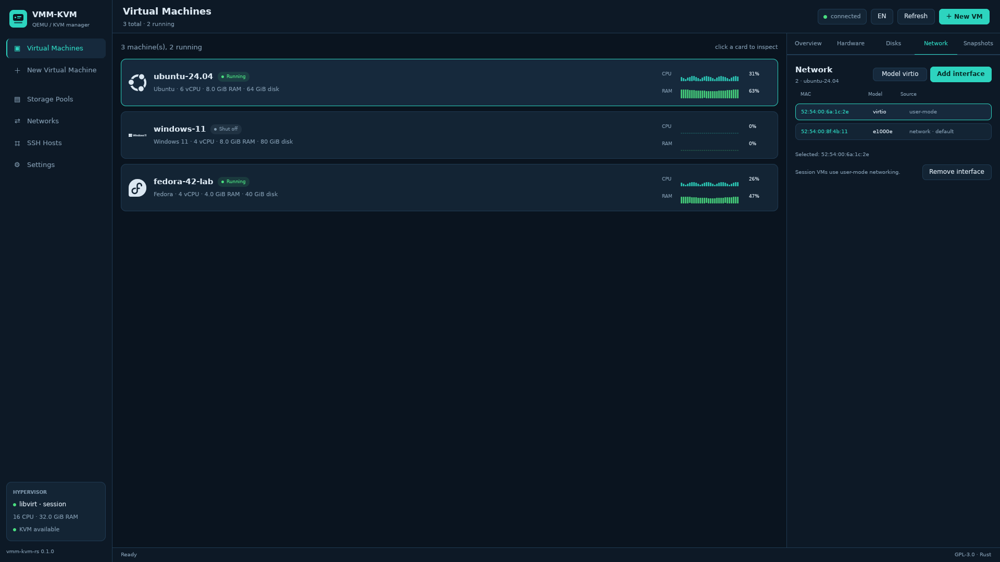
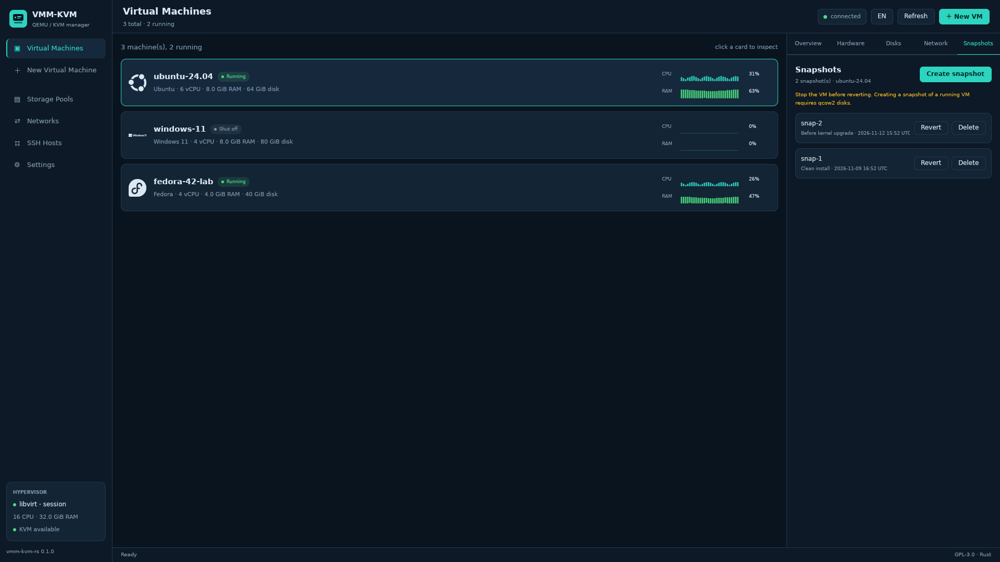
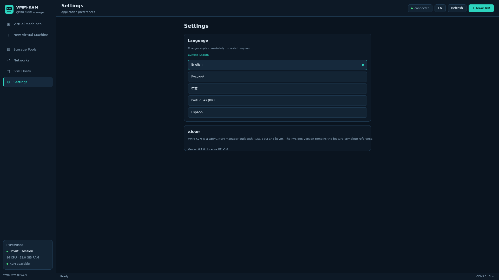

# VMM-KVM

**A native QEMU/KVM manager for Linux.** Rust, [gpui](https://github.com/zed-industries/zed/tree/main/crates/gpui) and libvirt — no Qt, no GTK, no browser runtime.

[](https://www.rust-lang.org/)
[](https://github.com/zed-industries/zed/tree/main/crates/gpui)
[](https://libvirt.org/)
[](https://kernel.org/)
[](LICENSE)



VMM-KVM gives you the everyday QEMU/KVM workflow in one window: see your machines, start and stop them, create a new VM from an ISO in a couple of clicks, change hardware, attach disks and ISOs, manage network interfaces and take snapshots. It connects to the unprivileged libvirt session by default, so it works without root and without a system-wide setup.

The screenshots in this README were captured with demo data. No real VM names, home directories or personal files are shown.

## Why this project exists

Most Linux VM managers are either tied to a heavy desktop stack, built around a remote management platform, or require you to remember a pile of `virsh` and `qemu-img` commands for simple tasks. VMM-KVM is a deliberately small desktop application:

- direct libvirt access, no daemon of its own;
- session VMs by default, system VMs when you need them;
- one screen for creation instead of a multi-step wizard;
- all VM XML edits stay inspectable and reversible;
- a native GPU-rendered interface that stays responsive while machines run.

This repository is the Rust port of the [PySide6 VMM-KVM](https://github.com/frankrukatlx102-wq/vmm-kvm). The Python application remains the feature-complete reference; this port focuses on the core workflow and a clean native foundation.

## Features

### Virtual machines

- VM list with state badges, OS icons and live CPU/RAM sparklines
- Start, graceful shutdown, force off, reboot, pause and resume
- SPICE/VNC console through `virt-viewer` or `remote-viewer`
- Live statistics refreshed every second
- Autostart handling through libvirt
- Safe deletion: modal confirmation, running-VM guard and a `domain.xml.bak` backup

### One-screen creation

- installation media list plus a native local ISO picker
- automatic OS detection from the ISO filename
- 39 OS profiles: Windows 95 through Windows 11, major Linux distributions, BSD and Android
- sensible defaults per profile: chipset, disk bus, network model, video model, UEFI and TPM
- host-aware limits for vCPU and RAM
- disk size, KVM acceleration and an automatically generated unique VM name
- inline name editing with UTF-8 support and manual/automatic modes

### Hardware

- vCPU and RAM with host maximums
- KVM acceleration toggle
- UEFI firmware toggle with automatic q35 selection
- TPM 2.0 toggle
- video model cycle: qxl, virtio, vga
- autostart
- UEFI fallback to an explicit OVMF loader on older libvirt versions

### Storage

- disk list with target, bus, size and image file
- add qcow2 disks with size and bus selection
- remove disk devices without deleting the image file
- attach and eject ISO media
- running VMs receive live changes when the hypervisor supports them; otherwise changes apply after restart

### Networking

- interface list with MAC, model and source
- add interfaces with virtio, e1000e or rtl8139 models
- session VMs use user-mode networking automatically; system VMs use the libvirt `default` network
- remove interfaces without touching the guest

### Snapshots

- snapshot list with description and creation time
- create snapshots with automatic names
- revert to a snapshot
- delete snapshot metadata
- clear warning when reverting a running VM

### Interface

- dark teal theme with a custom app mark
- five languages with **live switching**: English, Русский, 中文, Português (BR), Español
- selected language is persisted in `~/.config/vmm-kvm/language`
- system locale is used on first launch
- clear status bar for successful operations and errors

## Screenshots

| Create a virtual machine | Hardware |
|:---:|:---:|
|  |  |

| Disks | Network |
|:---:|:---:|
|  |  |

| Snapshots | Settings and languages |
|:---:|:---:|
|  |  |

## How it works

```
┌─────────────────────────────────────────────────────────┐
│                     gpui window (src/ui.rs)             │
│  sidebar · VM list · create screen · details tabs       │
│  state → render → click/keyboard handlers → notify      │
└───────────────────────────┬─────────────────────────────┘
                            │
┌───────────────────────────▼─────────────────────────────┐
│                  libvirt backend (src/backend.rs)       │
│  virt crate · xmltree · qemu-img · virt-viewer          │
│  session connection first, system connection fallback   │
└───────────────────────────┬─────────────────────────────┘
                            │
┌───────────────────────────▼─────────────────────────────┐
│                       QEMU / KVM                        │
│  domains · snapshots · disks · network interfaces       │
└─────────────────────────────────────────────────────────┘
```

The UI is an immediate-mode view: every state change marks the view dirty and the next frame rebuilds the element tree. A background timer samples CPU time and memory every second and refreshes the VM list every two seconds. Clicking a card loads its inactive XML and derives the Overview, Hardware, Disks, Network and Snapshots data from it.

The backend edits the **inactive** domain XML for persistent changes, then redefines the domain. Where libvirt supports hot-plug, the same change is also sent to the live domain; if hot-plug is not available, the configuration is still saved and takes effect on the next start. Disk images are created with `qemu-img` and use qcow2. ISO files are attached as SATA or IDE CD-ROM devices depending on the machine type.

The application does not run a privileged helper. It connects to libvirt exactly like `virsh` does:

- `qemu:///session` first — unprivileged, per-user VMs, no extra setup;
- `qemu:///system` as a fallback — system VMs, `libvirtd`, group membership required.

VM images created by the application live under `~/VirtualMachines/vms/<name>/`, and the ISO library is `~/VirtualMachines/iso/`.

## Requirements

- Linux with libvirt and QEMU/KVM
- `qemu-img` for disk creation
- `virt-viewer` or `remote-viewer` for the graphical console
- `xdg-desktop-portal` for the local ISO picker; `zenity` is used as a fallback
- a CJK font such as Noto Sans CJK for the Chinese interface
- Rust 1.92 or newer (edition 2024)
- development packages for libvirt, Vulkan, Wayland/X11, fontconfig and freetype

## Installation

### 1. Install system dependencies

The package names differ by distribution. Pick your family:

**Debian / Ubuntu / Linux Mint**

```bash
sudo apt update
sudo apt install build-essential pkg-config libvirt-dev libssl-dev \
  libxkbcommon-dev libwayland-dev libvulkan-dev libfontconfig1-dev \
  libfreetype-dev qemu-system-x86 qemu-utils virt-viewer \
  xdg-desktop-portal
```

**Fedora**

```bash
sudo dnf install gcc gcc-c++ make pkgconf-pkg-config libvirt-devel openssl-devel \
  libxkbcommon-devel wayland-devel vulkan-loader-devel fontconfig-devel \
  freetype-devel qemu-kvm qemu-img virt-viewer xdg-desktop-portal
```

**Arch Linux / Manjaro / EndeavourOS**

```bash
sudo pacman -S --needed base-devel pkgconf libvirt openssl libxkbcommon \
  wayland vulkan-icd-loader fontconfig freetype2 qemu-full virt-viewer \
  xdg-desktop-portal
```

**openSUSE**

```bash
sudo zypper install gcc gcc-c++ make pkg-config libvirt-devel libopenssl-devel \
  libxkbcommon-devel wayland-devel vulkan-loader-devel fontconfig-devel \
  freetype2-devel qemu-kvm qemu-tools virt-viewer xdg-desktop-portal
```

The Chinese UI additionally needs CJK fonts. Most desktops already provide them; on a minimal system install `noto-fonts-cjk` (Arch) or `fonts-noto-cjk` (Debian/Ubuntu).

### 2. Install Rust

The recommended way is [rustup](https://rustup.rs/):

```bash
curl --proto '=https' --tlsv1.2 -sSf https://sh.rustup.rs | sh
source "$HOME/.cargo/env"
```

A distribution Rust package works too, as long as it supports edition 2024.

### 3. Build

```bash
git clone https://github.com/frankrukatlx102-wq/vmm-kvm-rs.git
cd vmm-kvm-rs
cargo build --release
```

The first build takes a few minutes because gpui and its rendering stack are compiled from source. Later builds are incremental.

### 4. Run

```bash
./target/release/vmm-kvm-rs
```

or during development:

```bash
cargo run
```

The application looks for `assets/` next to the executable, then in `$XDG_DATA_HOME/vmm-kvm/assets` (usually `~/.local/share/vmm-kvm/assets`), then in the build-time project directory. OS icons and the app icon come from this directory.

### 5. Optional: install for the current user

```bash
install -Dm755 target/release/vmm-kvm-rs ~/.local/bin/vmm-kvm-rs
install -d ~/.local/share/vmm-kvm
cp -r assets ~/.local/share/vmm-kvm/assets
install -Dm644 assets/icons/vmm-kvm-256.png \
  ~/.local/share/icons/hicolor/256x256/apps/vmm-kvm.png
```

Create `~/.local/share/applications/vmm-kvm.desktop`:

```ini
[Desktop Entry]
Type=Application
Name=VMM-KVM
GenericName=Virtual Machine Manager
Comment=Manage QEMU/KVM virtual machines
Exec=vmm-kvm-rs
Icon=vmm-kvm
Terminal=false
Categories=System;Emulator;
Keywords=qemu;kvm;libvirt;virtualization;
StartupWMClass=vmm-kvm
```

Make sure `~/.local/bin` is in your `PATH`, then refresh the desktop database:

```bash
update-desktop-database ~/.local/share/applications 2>/dev/null || true
```

The icon appears in application menus and launchers. gpui does not expose a separate window-icon API on Wayland; the desktop entry and the in-app logo cover launchers and menus.

### libvirt notes

Session mode works out of the box:

```bash
virsh -c qemu:///session list --all
```

For system VMs, enable the daemon and add your user to the `libvirt` group:

```bash
sudo systemctl enable --now libvirtd
sudo usermod -aG libvirt "$USER"
```

Log out and back in after changing groups. If the session connection fails, VMM-KVM automatically tries `qemu:///system` and shows a clear error screen with a retry button.

The program uses the same permissions as `virsh`; it does not use `sudo`, polkit prompts or a setuid helper.

## First run

1. Start the application.
2. The sidebar shows the libvirt connection (`session` or `system`), host CPU/RAM and KVM availability.
3. Put one or more `.iso` files into `~/VirtualMachines/iso/`, or use **Choose ISO…** for a file anywhere on the disk.
4. Press **New VM**.
5. Select the installation media. The OS and version are detected from the filename; the matching OS profile is highlighted.
6. Adjust the name and hardware if needed.
7. Press **Create virtual machine**.

The new VM appears in the list and is selected automatically. Press **Start**, then **Console** to open the installer through `virt-viewer`.

## Usage guide

### Power controls

The Overview tab shows the state and the available actions:

- **Start** — boot a stopped VM;
- **Shut down** — ACPI shutdown request;
- **Force off** — immediate power off, equivalent to pulling the plug;
- **Reboot** — ACPI reboot;
- **Pause / Resume** — suspend and resume the vCPUs;
- **Console** — open the SPICE/VNC display in `virt-viewer`.

Graceful shutdown requires a working ACPI daemon inside the guest. If the guest ignores it, use **Force off**.

### Creating a VM

**Installation media** lists every ISO in `~/VirtualMachines/iso`. **Choose ISO…** opens the system file picker and lets you use an ISO outside that folder. **No installation media** creates an empty VM that can boot from a disk or a later-attached ISO.

The **Operating system** grid lets you override the automatic detection. Each profile carries its own defaults:

- chipset (`q35` or `i440fx`);
- disk bus (`virtio`, `sata` or `ide`);
- network model (`virtio`, `e1000e`, `rtl8139`, `e1000`);
- video model (`qxl`, `virtio`, `vga`);
- UEFI and TPM requirements for Windows 11;
- recommended vCPU, RAM and disk size.

Names are generated from the OS and ISO version, for example `ubuntu-24.04` or `windows-11`. You can type your own name directly in the field; the badge switches from **auto-generated** to **custom**. Names must be non-empty and unique, may contain letters, digits, dots, dashes, underscores and spaces. **Reset to auto** returns to the generated name.

vCPU and RAM steppers are clamped to the real host limits. KVM acceleration is enabled when `/dev/kvm` exists; without it QEMU falls back to software emulation.

### Hardware changes

The Hardware tab edits the persistent configuration:

- **vCPU** and **Memory** — stored in the inactive XML; a running VM may keep its current values until restart;
- **KVM acceleration** — switches the domain type between `kvm` and `qemu`;
- **UEFI firmware** — enables OVMF; q35 is selected automatically;
- **TPM 2.0** — adds an emulated TPM 2.0 backend;
- **Autostart** — starts the VM with the libvirt daemon;
- **Video model** — qxl, virtio or vga.

Press **Apply hardware changes**. The status bar tells you whether the change was applied live or deferred until the next start. If libvirt cannot find OVMF for a UEFI domain, the application retries with an explicit loader and creates a per-VM NVRAM file.

### Disks and ISO media

The Disks tab shows every disk device, including CD-ROM media.

- **Add disk** opens an inline form: choose size (5–2000 GiB), bus (virtio, sata, ide, scsi) and press **Create disk**. A new qcow2 image is created in the VM directory as `diskN.qcow2`.
- **Attach ISO…** picks a local ISO and inserts it as a CD-ROM. If the VM has no CD-ROM yet, one is created on SATA (q35) or IDE (i440fx).
- **Eject ISO** removes the media source but keeps the CD-ROM device.
- **Remove disk** removes the selected disk device. The image file stays on disk — the application never deletes user data.

Running VMs receive live disk/ISO changes when QEMU supports them; otherwise the configuration is saved for the next start.

### Network interfaces

The Network tab lists MAC address, model and source.

- **Model** cycles through virtio, e1000e and rtl8139.
- **Add interface** appends an interface. Session VMs get user-mode networking, system VMs use the default libvirt network.
- **Remove interface** removes the selected MAC from the VM configuration.

Live attach/detach is attempted for running VMs; changes that cannot be hot-plugged are kept in the configuration.

### Snapshots

Snapshots capture the disk state of the selected VM.

- **Create snapshot** generates `snap-1`, `snap-2`, … and stores a description.
- **Revert** restores the snapshot; stop the VM first for the most reliable result.
- **Delete** removes the snapshot metadata.

Snapshot creation requires qcow2 disks. A running VM may refuse to snapshot depending on the QEMU and libvirt versions; the error is shown in the status bar.

### Console

The Console button launches:

```bash
virt-viewer -c qemu:///session <vm-name>
```

`remote-viewer` is used when `virt-viewer` is not installed. The VM must be running and expose a SPICE or VNC graphics device. The application creates SPICE graphics with `listen=127.0.0.1` by default.

### Language

Switch languages in **Settings** or press the short language code in the toolbar (`EN`, `RU`, `中文`, `PT`, `ES`) to cycle. The change applies immediately to every screen, status message and new dialog — no restart. The selection is saved in:

```
~/.config/vmm-kvm/language
```

If no saved language exists, the system locale is used, then English.

## Files and configuration

| Path | Purpose |
|---|---|
| `~/VirtualMachines/iso/` | default ISO library |
| `~/VirtualMachines/vms/<name>/` | VM disk images and `domain.xml.bak` |
| `~/.config/vmm-kvm/language` | saved interface language |
| `$XDG_DATA_HOME/vmm-kvm/assets` | installed icons and SVG assets |
| `~/.local/share/applications/vmm-kvm.desktop` | optional desktop entry |

The application does not keep a separate database. The source of truth is the libvirt domain XML, so `virsh dumpxml` and VMM-KVM always show the same configuration.

## Testing

The backend has a built-in end-to-end self-test. It uses the session libvirt connection and only creates VMs whose names start with `vmmself-rs-`:

```bash
cargo run -- --selftest
```

The test covers:

- BIOS VM creation with `qemu-img`;
- hardware read/write and persistence;
- disk creation, removal and ISO attach/eject;
- network interface creation and removal;
- snapshot creation, listing and deletion;
- VM start, running state and statistics;
- force off and cleanup;
- UEFI/q35 domain definition;
- VM creation with installation ISO.

Every test VM, disk directory and temporary ISO is removed after the run. If a test fails, the cleanup path still runs. The self-test never touches VMs outside the `vmmself-rs-*` namespace.

Development checks:

```bash
cargo fmt --check
cargo clippy
cargo build --release
```

The project has no unit-test suite for gpui rendering; UI verification is done manually on a real Wayland/X11 session.

## Project structure

```text
src/
  main.rs       application entry point, assets, CLI self-test
  ui.rs         gpui view: sidebar, VM list, create screen, tabs, dialogs
  backend.rs    libvirt connection, XML edits, disks, networks, snapshots
  osdata.rs     39 OS profiles and ISO filename detection
  hostinfo.rs   host RAM/CPU limits and /dev/kvm detection
  i18n.rs       translation table, language persistence
assets/
  icons/os/     36 OS SVG icons
  icons/vmm-kvm.svg, vmm-kvm.png, vmm-kvm-256.png
docs/screenshots/
  README screenshots captured with demo data
```

## Development notes

This port was built core-first:

1. OS profiles, ISO detection and host limits;
2. a libvirt backend with domain XML editing, UEFI fallback, disk and network devices, snapshots and a self-test;
3. the gpui window: VM list, overview, hardware, disks, network and snapshots;
4. creation flow, manual names, local ISO picker, localization and the safety pass.

Design choices:

- **gpui** gives GPU-rendered layout and text without pulling in GTK/Qt.
- **virt** is a thin, safe Rust wrapper around libvirt; **xmltree** keeps XML edits explicit.
- **rfd** provides the native file picker through the desktop portal.
- The UI keeps no hidden state beyond what the libvirt XML says.
- Destructive operations are explicit: a modal confirmation, a stopped-VM requirement and an XML backup.
- The self-test is part of the binary so contributors can verify the backend without a second test harness.

The Python/PySide6 application remains the reference for features that are still missing here, such as storage pool browsing, SSH hosts and VM import.

## Troubleshooting

| Problem | Solution |
|---|---|
| **Cannot connect to libvirt** | Install libvirt and start the session daemon; check `virsh -c qemu:///session list --all`. For system VMs start `libvirtd` and join the `libvirt` group. |
| **KVM unavailable** | Check `/dev/kvm`; enable AMD-V/Intel VT-x in firmware; load `kvm_amd` or `kvm_intel`. The app still runs with software emulation. |
| **UEFI VM fails to define** | Install OVMF/edk2-ovmf. The app falls back to an explicit loader if firmware auto-selection fails. |
| **No console window** | Install `virt-viewer` or `remote-viewer`; make sure the VM is running and has SPICE/VNC graphics. |
| **ISO picker does not open** | Install `xdg-desktop-portal` for your desktop and `zenity` as a fallback. |
| **Chinese text shows boxes** | Install Noto Sans CJK or another CJK font and restart the app. |
| **RAM/vCPU change did not apply** | Running VMs may not support hot-plug. Stop the VM; the saved configuration applies on the next start. |
| **Snapshot fails on a running VM** | Shut the VM down and create the snapshot while it is stopped. |
| **VM disappeared after delete** | Disk images are intentionally kept. Restore the definition from `~/VirtualMachines/vms/<name>/domain.xml.bak` with `virsh define`. |
| **Window has no icon in the taskbar** | gpui 0.2.2 has no Wayland window-icon API. Install the `.desktop` file so launchers and taskbars use the app icon. |

## Roadmap

- [x] VM creation with ISO detection and host-capped resources
- [x] Hardware, disks, network interfaces and snapshots
- [x] Manual VM names and local ISO picker
- [x] Five-language live localization
- [ ] Storage pool browser
- [ ] SSH hosts and remote libvirt connections
- [ ] VM clone and import
- [ ] Secure Boot and TPM provisioning controls
- [ ] More detailed guest-agent integration

## Contributing

Issues and pull requests are welcome. Keep changes focused and test the libvirt layer with `--selftest` before opening a PR. The UI follows the existing dark theme and the one-screen creation model; new screens should fit the sidebar instead of introducing separate windows.

For bug reports include:

- distribution and libvirt/QEMU versions;
- whether the connection is `session` or `system`;
- the exact error from the status bar or `virsh`;
- whether the VM is running.

## License

Copyright (C) 2026 VMM-KVM contributors.

This program is free software: you can redistribute it and/or modify it under the terms of the **GNU General Public License version 3** as published by the Free Software Foundation.

This program is distributed in the hope that it will be useful, but **without any warranty**; without even the implied warranty of merchantability or fitness for a particular purpose. See the GNU General Public License for more details.

You should have received a copy of the GNU General Public License along with this program. If not, see <https://www.gnu.org/licenses/>.

The full license text is in [LICENSE](LICENSE). SPDX identifier: `GPL-3.0-only`.
